<p align="center">
  <picture><source media="(max-width: 767px)" srcset="assets/readme/banner-m.svg"></picture>
</p>

In a quality-managed company, every controlled document has to be built on the current approved template. A document started from an old copy gets caught late, in review, and goes back to its author. This tool catches it first: it reads the Template ID and version from the document's footer, looks them up in the master template list and returns one of four verdicts with a plain message.

<p align="center">
  <picture><source media="(max-width: 767px)" srcset="assets/readme/proof-m.svg"></picture>
</p>

## How it works

<p align="center">
  <picture><source media="(max-width: 767px)" srcset="assets/readme/how-it-works-m.svg"></picture>
</p>

The decision is **deterministic**: a regex and a table lookup, with no AI in the
decision path. That matters in a regulated environment, because a rule-based check is far
easier to validate and audit than a probabilistic one. OCR is only used as a
fallback for scanned PDFs with no text layer.

## Architecture

<p align="center">
  <picture><source media="(max-width: 767px)" srcset="assets/readme/architecture-m.svg"></picture>
</p>

## Files

| File | Purpose |
|---|---|
| `master_list.xlsx` | Mock master list of Template IDs, versions, and statuses (placeholder for the real QMS export) |
| `extractor.py` | Pulls Template ID + Version from a docx/pdf footer |
| `checker.py` | Looks up the extracted ID against the master list, returns a verdict |
| `app.py` | Streamlit demo UI — upload a document, get an instant verdict |
| `sample_docs/` | 4 sample documents, one per verdict type |
| `tests/test_cases.py` | 31 checks across every verdict path and the edge cases below |

## Run it

```bash
pip install python-docx pdfplumber pandas openpyxl streamlit
python3 tests/test_cases.py      # run the test suite (prints a pass/fail summary)
streamlit run app.py             # launch the demo UI
```

## Verdicts

| Verdict | Meaning |
|---|---|
| ✅ PASS | Template is Effective and on the latest version |
| ⚠️ WARN | Template is Effective, but a newer version exists |
| ❌ FAIL | Template is Superseded or Withdrawn |
| ❓ FLAG | Template ID missing/unreadable, or not found in the master list |

## Note on the master list

`master_list.xlsx` is realistic **mock data** — Alcon's actual internal QMS
template register is proprietary and not accessible outside the company. The
column structure (`Template_ID`, `Template_Name`, `Category`, `Latest_Version`,
`Status`, `Effective_Date`, `Superseded_By`, `Owner_Department`) mirrors a real
template register, and the file has been internally cross-checked (no duplicate
IDs, every `Superseded_By` points to a valid Effective template). Swap in the
real QMS export on presentation day — no code changes needed as long as the
column headers match.

## Tested edge cases

The suite in `tests/test_cases.py` has 31 checks in 4 sections: master list
integrity, direct lookup logic, end-to-end file tests, and edge cases. On a
fresh machine 29 pass. The other two convert `.docx` to PDF through a
LibreOffice helper at a fixed path (`/mnt/skills/public/docx/scripts/office/soffice.py`)
from the environment the tests were written in, so they fail anywhere else
until that path is changed. The edge-case section covers issues found (and
fixed) while stress-testing this build:

- Lowercase / ALL CAPS Template IDs and version labels
- Non-numeric version strings (e.g. a letter-based "Rev C" scheme) — flags
  for manual review instead of crashing
- Corrupt, empty, missing, or unsupported files — graceful error, not a crash
- A document with no footer stamped at all
- Footer content laid out in a table instead of plain text (common in real
  controlled templates)
- "Revision:" and "Rev." wording, not just "Version:"
- A genuinely scanned PDF with no text layer at all — real OCR fallback via
  Tesseract, verified end-to-end, not just a code path that's never exercised
- Both `.docx` and `.pdf` produce identical verdicts for the same content
- A malformed master list entry (non-numeric version) doesn't crash the checker

**Known limitations, worth confirming with QA before rollout:**
- Version numbers are compared as decimals (`3.0` < `3.12`). If Alcon's real
  versioning scheme uses `Major.Minor` where Minor is a sequential integer
  rather than a decimal fraction (e.g. `3.9` should be considered *older*
  than `3.10`, not newer), this comparison would need to change to split on
  the dot and compare each part as an integer.
- If a footer happens to contain more than one Template ID (e.g. referencing
  both an old and new ID for context), only the first match found is used.
- OCR accuracy on real scanned documents depends on scan quality — a fuzzy
  matcher (e.g. `rapidfuzz`) is recommended as a production hardening step to
  catch near-misses like a `0` OCR'd as `O`.

## Scaling to 1,000 docs/day

- Replace the single-script flow with a queue-based service: a watched
  SharePoint/QMS folder → message queue (Celery/RabbitMQ or Azure Functions) →
  worker pool runs extract+check → results written to a database.
- Cache the master list in memory/Redis, refreshed on a schedule instead of
  reading the Excel file per document.
- Track extraction-failure and "ID not found" rates as leading indicators that
  the regex or master list needs attention.

<p align="center">
  <a href="https://github.com/JustKamlesH21"><picture><source media="(max-width: 767px)" srcset="assets/readme/footer-m.svg"></picture></a>
</p>
